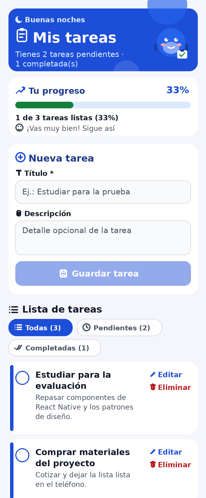
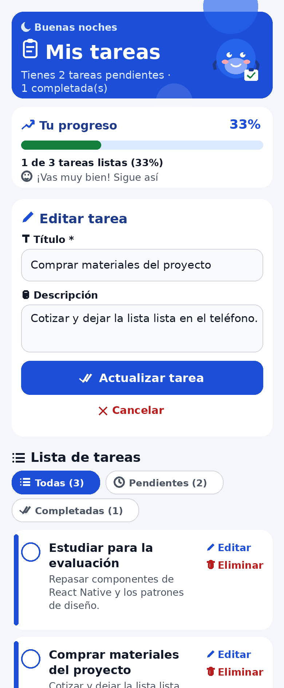
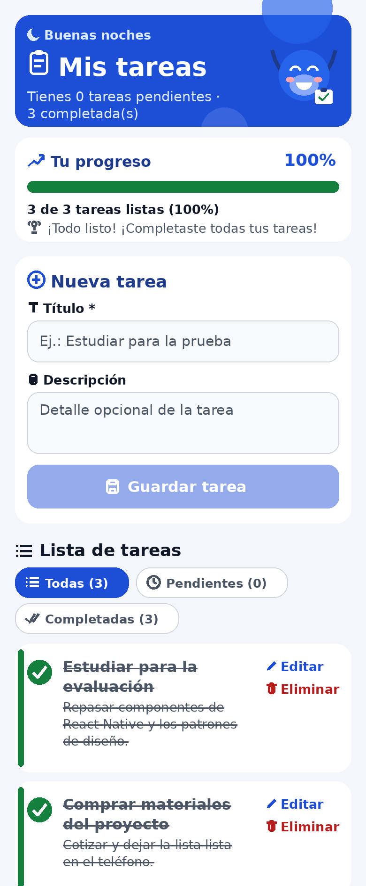

# Mis Tareas — Aplicación de lista de tareas con Expo y React Native

**Código fuente:** [https://github.com/neervison/mis-tareas-expo](https://github.com/neervison/mis-tareas-expo)

**Asignatura:** IF206IINF Desarrollo de Aplicaciones Móviles
**Integrantes:** Neervison Bonny Laguna Sánchez, Carlos Oriel Álvarez Arévalo
**Proyecto:** Aplicación móvil de lista de tareas (To-Do List): **agregar, editar, eliminar y marcar completadas**, cada tarea con **título y descripción**.

> **Elección del framework:** para este proyecto se eligió **Expo con React Native y TypeScript**. No es una elección arbitraria: la sección [¿Por qué usamos estas tecnologías?](#por-qué-usamos-estas-tecnologías) explica qué aporta cada una y por qué se usa aquí, y la tabla [Componentes de la interfaz](#componentes-de-la-interfaz-y-su-implementación-en-este-proyecto) muestra cómo se construyó cada pieza de la pantalla.

Este README está ordenado **por pasos, desde cero**: si sigues los pasos 1 al 11 entiendes cómo se creó la app, por qué se hizo así y cómo probarla. Para probarla tú mismo en tu PC, ve directo a la sección **[Cómo probar el código tú mismo](#cómo-probar-el-código-tú-mismo)**.

---

## Capturas de la aplicación

Las tres capturas reproducen fielmente la app real (mismos colores de `src/tema/`, mismos textos e iconos de los componentes, mismas tareas de ejemplo de `useTareas.ts`), en formato teléfono. Ninguna usa emoticones: los iconos son **vectoriales profesionales (Ionicons)**.

### Captura 1 — Pantalla principal



**Qué se ve y qué demuestra:** arriba, el **encabezado** con degradado azul, el **saludo según la hora** («Buenas noches» con icono de luna) y la **mascota en estado contenta** porque hay avance; el resumen «Tienes 2 tareas pendientes · 1 completada(s)» evidencia los **contadores derivados** del hook. Debajo, la **barra de progreso** muestra «1 de 3 tareas listas (33%)» con su mensaje dinámico: es la retroalimentación inmediata para el usuario. El **formulario** «Nueva tarea» muestra los campos Título y Descripción con iconos profesionales, y el botón «Guardar tarea» **atenuado** porque el título está vacío: eso demuestra la **validación visible**. Siguen el título de la lista y los **chips de filtro con sus conteos** (Todas (3) activa en azul), y las tarjetas de tarea con **borde izquierdo de color según estado**, checkbox circular, y acciones «Editar» y «Eliminar» con icono + palabra. La tercera tarea (fuera de este recorte) está completada y tachada. En conjunto, la captura evidencia jerarquía visual, contraste AA y la consistencia de los componentes.

### Captura 2 — Modo edición



**Qué se ve y qué demuestra:** el mismo formulario, ahora en **modo edición**: su título cambió a «Editar tarea» (icono de lápiz), los campos llegaron **cargados** con los datos de «Comprar materiales del proyecto», el botón principal dice **«Actualizar tarea»** (icono de doble check, ya habilitado en azul pleno porque el título es válido) y apareció la opción **«Cancelar»** con su icono de cierre para salir sin guardar. Demuestra la función de **editar tareas** con **un solo formulario para dos modos** (patrón de componente controlado), y que la interfaz comunica en qué modo está sin que el usuario adivine: eso es usabilidad en la práctica.

### Captura 3 — Todo completado: la mascota celebra



**Qué se ve y qué demuestra:** el estado dinámico completo de la app. Las tres tareas están **completadas** (checkbox verde con check, texto tachado, borde izquierdo verde), los chips muestran **Pendientes (0)** y **Completadas (3)**, la **barra de progreso llegó al 100%** («3 de 3 tareas listas») y el mensaje cambió a **«¡Todo listo! ¡Completaste todas tus tareas!»** con icono de trofeo. Lo más importante: la **mascota está CELEBRANDO** — brazos arriba, ojos de alegría y sonrisa grande — comparada con su estado contento de la Captura 1. Demuestra la **retroalimentación al usuario en todos los niveles** (número, barra animada, mensaje, personaje) y el comportamiento reactivo de React: al cambiar el estado, toda la interfaz se actualiza sola.

---

## Paso 1 — Instalar Node.js (el entorno de trabajo)

**Qué se hace:** instalar Node.js 20 o superior desde https://nodejs.org y verificar con:

```bash
node -v
```

**Por qué:** Node.js **no es la app**: es el entorno que ejecuta las herramientas JavaScript del proyecto. Sin Node no funcionan `npm`/`npx`, que son los comandos con los que se crea el proyecto, se instalan dependencias y se levanta la app.

**Qué debería verse:** un número de versión, por ejemplo `v24.22.1` (la versión con la que se probó este proyecto; ver Paso 11).

---

## Paso 2 — Crear el proyecto con create-expo-app (la base)

**Qué se hace:**

```bash
npx create-expo-app tareas-expo --template blank-typescript
```

**Por qué Expo:** se eligió porque entrega el proyecto listo para **Android, iOS y Web con un solo código**, sin configurar Android Studio ni Xcode de forma compleja, y permite probar en el teléfono real con **Expo Go** escaneando un QR, sin compilar. Frente a desarrollar una app por separado para cada sistema, un solo código reduce el trabajo y los errores. La plantilla `blank-typescript` parte en blanco pero ya con TypeScript configurado, así los errores de tipos se detectan desde el inicio.

**Qué debería verse:** una carpeta `tareas-expo/` con `App.tsx`, `index.ts`, `app.json`, `package.json` y `tsconfig.json`.

---

## Paso 3 — Instalar las dependencias

**Qué se hace** (dentro de la carpeta del proyecto):

```bash
cd tareas-expo
npm install
```

**Por qué:** descarga las librerías que la app necesita (Expo SDK 58, React 19.3, React Native 0.88, `react-native-safe-area-context`, `expo-status-bar`) y las deja en `node_modules/` (esa carpeta **no se entrega**: se regenera con este comando).

**Qué debería verse:** termina sin errores y aparece/actualiza `package-lock.json`.

---

## Paso 4 — Ordenar la estructura de carpetas

**Qué se hace:** crear la carpeta `src/` con una subcarpeta por responsabilidad:

```
tareas-expo/
├── App.tsx                  ← SOLO raíz de composición: muestra la pantalla (sin lógica)
├── index.ts                 ← Punto de entrada: registra App en Expo (no se toca)
├── app.json                 ← Configuración de la app (nombre "Mis Tareas", ícono, orientación)
├── package.json             ← Dependencias y scripts (start, android, ios, web, typecheck, lint)
├── tsconfig.json            ← Configuración de TypeScript (modo estricto)
├── eslint.config.js         ← Reglas de ESLint (configuración oficial de Expo)
├── .prettierrc.json         ← Reglas de formato automático (Prettier)
├── .editorconfig            ← Mismo formato para cualquier editor
├── README.md                ← Este documento
├── capturas/                ← Capturas de pantalla de la app (las de este README)
└── src/
    ├── pantallas/
    │   └── PantallaTareas.tsx   ← La PANTALLA completa: compone todo y maneja la edición/eliminación
    ├── componentes/             ← Piezas de interfaz reutilizables (solo dibujan)
    │   ├── Encabezado.tsx       ← Saludo según la hora + título + resumen + la mascota
    │   ├── Mascota.tsx          ← Personaje SVG que reacciona al avance (duerme/contenta/celebra)
    │   ├── BarraProgreso.tsx    ← Barra animada de % completado + mensaje dinámico
    │   ├── FiltrosTareas.tsx    ← Chips Todas / Pendientes / Completadas con conteos
    │   ├── FormularioTarea.tsx  ← Formulario controlado: crear y editar
    │   ├── TareaItem.tsx        ← Tarjeta de una tarea: checkbox, editar, eliminar
    │   ├── EstadoVacio.tsx      ← Mensaje cuando la lista se ve vacía (según el filtro)
    │   └── index.ts             ← "Barrel": re-exporta todos los componentes
    ├── hooks/
    │   └── useTareas.ts         ← La LÓGICA: estado y operaciones de las tareas
    ├── servicios/
    │   ├── validacionTarea.ts   ← Reglas puras: título obligatorio y normalización (trim)
    │   └── filtradoTareas.ts    ← Regla pura: qué tareas se muestran según el filtro
    ├── modelos/
    │   └── tarea.ts             ← Interfaz Tarea, DatosTarea y el tipo FiltroTareas
    ├── constantes/
    │   ├── limites.ts           ← Límites con nombre (largo máximo de título y descripción)
    │   └── mensajes.ts          ← Textos dinámicos: saludo por hora, mensajes de progreso y de lista vacía
    ├── utilidades/
    │   └── ids.ts               ← generarId(): crea el id único de cada tarea
    └── tema/                    ← TOKENS DE DISEÑO (valores con nombre, un solo lugar)
        ├── colores.ts           ← Paleta de colores
        ├── espaciado.ts         ← Espaciados (8/16/24/32) y radios
        ├── tipografia.ts        ← Escala de tamaños de fuente
        └── index.ts             ← "Barrel": re-exporta todos los tokens
```

**Por qué:** cada carpeta responde a una pregunta: **pantallas** = ¿qué pantalla se muestra? · **componentes** = ¿cómo se ve? · **hooks/servicios** = ¿qué hace y qué reglas cumple? · **modelos** = ¿cómo son los datos? · **tema** = ¿con qué estilo? · **constantes/utilidades** = valores y ayudantes compartidos. Así el proyecto es fácil de explicar y de modificar (patrón de **separación de responsabilidades**). El detalle profesional de esta estructura está en la sección **[Estructura profesional y buenas prácticas](#estructura-profesional-y-buenas-prácticas)**.

---

## Paso 5 — El modelo de datos: `src/modelos/tarea.ts`

**Qué se hace:** definir con TypeScript la forma de una tarea:

```typescript
export interface Tarea {
  id: string;            // identificador único
  titulo: string;        // obligatorio (lo valida el formulario)
  descripcion: string;   // opcional, puede ir vacía
  completada: boolean;   // true = tarea hecha (se ve tachada)
  fechaCreacion: number; // marca de tiempo de creación
}
```

(también define `DatosTarea`, que es solo título + descripción: lo que el formulario entrega al guardar).

**Por qué:** cada tarea necesita **título y descripción**; el modelo lo deja escrito en un solo lugar, con tipos. Con tipos, si a una tarea le falta el `titulo`, TypeScript avisa antes de correr la app.

---

## Paso 6 — La lógica: hook `src/hooks/useTareas.ts`

**Qué se hace:** crear un *hook personalizado* que concentra el estado (`useState`) y todas las operaciones:

| Función | Qué hace | Cómo (estado inmutable) |
|---|---|---|
| `agregarTarea(datos)` | Agrega una tarea nueva al final, con id único y `fechaCreacion` | `setTareas([...previas, nueva])` |
| `actualizarTarea(id, datos)` | Reemplaza título y descripción de esa tarea | `map(...)` |
| `eliminarTarea(id)` | Quita esa tarea de la lista | `filter(...)` |
| `alternarCompletada(id)` | Marca/desmarca como completada | `map(...)` |
| `totalPendientes` / `totalCompletadas` | Contadores derivados para el encabezado | `useMemo` + `filter` |

Parte con 3 tareas de ejemplo (`TAREAS_INICIALES`) para que la app nunca se vea vacía al evaluarla. Dos ayudantes viven fuera del hook, porque no son su responsabilidad: el id de cada tarea lo crea `generarId()` de `src/utilidades/ids.ts`, y el texto se normaliza (trim) con `normalizarTexto()` del servicio de validación (`src/servicios/validacionTarea.ts`).

**Por qué un hook y no lógica en la pantalla:** la pantalla solo debería dibujar. Al separar la lógica en `useTareas`, cualquier componente puede usarla y el código se puede probar por partes (así se probó en el Paso 11). Que el estado sea **inmutable** (nunca se modifica el arreglo original, siempre se crea uno nuevo) es lo que permite que React detecte el cambio y vuelva a dibujar solo (patrón **observador**).

---

## Paso 7 — Los componentes de la interfaz: `src/componentes/`

### 7.1 `Encabezado.tsx` — equivale al `ion-header`
Muestra el **saludo según la hora** calculado con `Date` («Buenos días / tardes / noches» con su icono Ionicons de sol o luna, regla en `src/constantes/mensajes.ts`), el título «Mis tareas» (28 px, negrita, blanco sobre azul con **degradado simulado** en capas, sin librerías) con icono de portapapeles, y el resumen: «Tienes N tareas pendientes · M completada(s)». A la derecha va la **mascota** (7.5). Es **presentacional**: solo recibe los contadores por *props* y los dibuja; no guarda estado.

### 7.2 `FormularioTarea.tsx` — equivale al formulario con `ion-input` + `ion-button`
Formulario **controlado** (el valor de cada `TextInput` vive en el estado de React) con dos campos: título (una línea) y descripción (multilínea). Un solo formulario, dos modos:

- **Crear:** botón «Guardar tarea»; al guardar, **el formulario se limpia solo** y queda listo para la siguiente tarea.
- **Editar:** si recibe `tareaEnEdicion`, se llena con los datos, el botón cambia a «Actualizar tarea» y aparece «Cancelar».

Todos los textos del formulario llevan su **icono Ionicons** (título, descripción, guardar, actualizar, cancelar): iconos profesionales de trazo, no emoticones.

**Validación visible:** el título es obligatorio. Sin título, el botón se ve deshabilitado (opacidad 0,45) y al intentarlo se muestra «El título es obligatorio: escribe qué tienes que hacer.». La **regla y su mensaje no viven en el componente**: están en el servicio `src/servicios/validacionTarea.ts` (funciones puras `esTituloValido` / `validarTitulo`), y el formulario solo las usa. Los campos además limitan su largo con las constantes de `src/constantes/limites.ts` (`maxLength`: título 80, descripción 240 caracteres).

### 7.3 `TareaItem.tsx` — equivale a un `ion-item`
Tarjeta reutilizable que `FlatList` dibuja una vez por tarea: **[checkbox circular] título + descripción · [Editar] [Eliminar]**. Lleva un **borde izquierdo de color según el estado** (azul = pendiente, verde = completada) y las acciones con **icono Ionicons + palabra** (lápiz «Editar», basurero «Eliminar»): el icono acompaña, la palabra comunica. La tarea completada se ve tachada y atenuada, con el checkbox relleno en verde con ✓. No guarda estado: avisa hacia arriba con *callbacks* (`onAlternar`, `onEditar`, `onEliminar`).

### 7.4 `EstadoVacio.tsx` — el mensaje cuando la lista se ve vacía
Componente propio para el estado vacío de la lista. Con los filtros, «vacío» puede significar tres cosas y cada una muestra su mensaje con su **icono Ionicons grande**: hoja «No tienes tareas todavía», trofeo «¡No te queda nada pendiente!» (filtro Pendientes sin resultados) o reloj «Aún no completas ninguna tarea» (filtro Completadas). Los textos e iconos viven en `src/constantes/mensajes.ts` (`MENSAJES_VACIO`); el componente recibe el filtro activo y solo elige y dibuja.

### 7.5 `Mascota.tsx` — el personaje que reacciona a tu avance
Mascota dibujada con **react-native-svg** (vectorial, sin imágenes): un personaje redondo con su portapapeles con check. No es decoración suelta: **comunica el estado de la lista con su expresión**, en tres estados derivados del % de avance: **0% → duerme** (ojos cerrados, «Zzz»), **1–99% → contenta** (ojos con brillo, sonrisa, mejillas), **100% con tareas → celebra** (brazos arriba, ojos de alegría, sonrisa grande). Se anima solo con `Animated`: **flota** suave en loop, da un **saltito** cuando el % cambia y **se inclina de lado a lado** al llegar a 100%. Refuerza la información, nunca la reemplaza: el % sigue escrito en la barra y el resumen en el encabezado (por eso va oculta para lectores de pantalla).

### 7.6 `BarraProgreso.tsx` — tu avance, animado
Tarjeta con el **porcentaje de avance**: «Tu progreso» con icono de gráfico, la **barra que se rellena con animación** (`Animated` + interpolación de ancho, 600 ms) cada vez que el % cambia, el texto exacto «X de Y tareas listas (Z%)» y un **mensaje motivacional dinámico** según el avance (función pura `mensajeSegunProgreso` en `src/constantes/mensajes.ts`: partir → vas muy bien → ¡todo listo!, con su icono bandera/cara feliz/trofeo). Para lectores de pantalla se anuncia como barra de progreso con su valor.

### 7.7 `FiltrosTareas.tsx` — chips para mirar la lista de tres formas
Tres chips (píldoras) con **icono Ionicons + nombre + conteo**: **Todas / Pendientes / Completadas**. El activo se pinta en azul pleno y los demás en blanco con borde, así siempre se sabe en qué vista estás. Es presentacional: avisa el cambio con `onCambiarFiltro` y el **filtrado real** lo hace la función pura `filtrarTareas` del servicio `src/servicios/filtradoTareas.ts`, que la pantalla aplica con `useMemo`. En una app de una sola pantalla, estos chips + el encabezado cumplen el rol de **menú/navegación** entre vistas de la lista.

> Todos los componentes se importan desde el *barrel* `src/componentes/index.ts`, que los re-exporta en un solo lugar.

**Por qué componentes:** la interfaz se arma con piezas pequeñas, reutilizables y combinables (**arquitectura basada en componentes**); cada pieza se entiende y se cambia por separado.

---

## Paso 8 — El tema visual: tokens de diseño en `src/tema/`

**Qué se hace:** centralizar los valores de diseño como **tokens con nombre**, en una carpeta con un archivo por tipo de token:

- `colores.ts` — la paleta: primario `#1D4ED8` (encabezado y botón guardar), `primarioClaro` `#2563EB` (segunda capa del degradado del encabezado y cuerpo de la mascota), `pistaProgreso` `#DBEAFE` (fondo de la barra de progreso), `mejilla` `#FDA4AF` (mejillas de la mascota), texto `#111827`, texto secundario `#4B5563`, peligro `#B91C1C` (eliminar), éxito `#15803D` (completado), fondo `#F4F6FB`.
- `espaciado.ts` — espaciados en múltiplos de 8: **8 / 16 / 24 / 32**, y radios de borde 12 y 16.
- `tipografia.ts` — la escala de fuentes con nombre: `mini` 13, `pequena` 14, `mediana` 15, `base` 16, `subtitulo` 18, `titulo` 28, `iconoGrande` 44 (icono del estado vacío).
- `index.ts` — *barrel* que re-exporta todo: los componentes importan desde `'../tema'` en una línea.

**Por qué:** es la **fuente única de verdad** del diseño — para cambiar el color de toda la app se toca un solo valor, y ningún componente escribe medidas "a ojo". Funciona como un sistema de variables de tema: la identidad visual completa vive en un solo lugar.

---

## Paso 9 — Unir todo: la pantalla `src/pantallas/PantallaTareas.tsx` y `App.tsx`

**Qué se hace:** la **pantalla** (`PantallaTareas`) actúa como **contenedor**: usa `useTareas()` y reparte datos y funciones a los componentes presentacionales. `App.tsx`, en cambio, queda reducido a la **raíz de composición**: solo importa y muestra la pantalla, sin lógica ni estilos de pantalla (así se organizan los proyectos profesionales: el punto de entrada no hace el trabajo, lo delega). Estructura de la pantalla:

- `SafeAreaView`: el contenido no queda bajo el notch/barra del sistema.
- `KeyboardAvoidingView`: el formulario no queda tapado por el teclado.
- `FlatList` (equivale al `ion-list`): lista **virtualizada** — solo dibuja las tareas visibles — con encabezado compuesto por `Encabezado` (con la mascota) + `BarraProgreso` + `FormularioTarea` + título «Lista de tareas» + `FiltrosTareas`, y **estado vacío según el filtro** cuando no hay tareas que mostrar.
- El **filtro** vive como estado de la pantalla y la lista visible se calcula con `useMemo` + el servicio `filtrarTareas`: cambiar de chip no vuelve a pedir datos, solo re-filtra lo que ya hay.
- **Animaciones con `LayoutAnimation`:** al agregar, eliminar, completar o cambiar de filtro, la lista se reordena con una transición suave (en Android se habilita una vez con `UIManager`).
- Eliminar pasa por la pantalla, que pide **confirmación con `Alert`** antes de borrar.

**Qué debería verse:** encabezado azul con mascota → tarjeta de progreso → formulario → chips de filtro → lista de tareas, en ese orden (jerarquía visual).

---

## Paso 10 — Ejecutar la app

```bash
npx expo start
```

Al ejecutarlo aparece un **código QR**:

- **En el teléfono:** abre **Expo Go** y escanea el QR → la app se abre en tu teléfono real.
- **En el navegador:** presiona la tecla **`w`** → se abre la versión web.
- **Emulador Android:** presiona **`a`**
 (si tienes uno abierto).

Para detener el servidor: `Ctrl + C` en la terminal.

---

## Paso 11 — Pruebas realizadas

| Prueba | Comando / método | Resultado |
|---|---|---|
| Versión de Node.js | `node -v` | v24.22.1 ✅ |
| Versión de Expo | `npx expo --version` | 58.1.15 (SDK 58) ✅ |
| Tipos de TypeScript | `npm run typecheck` (`tsc --noEmit`) | Sin errores ✅ |
| Calidad de código (ESLint) | `npm run lint` (`expo lint`) | Sin problemas ✅ |
| Empaquetado web (Metro) | `npx expo export --platform web` | 416 módulos, bundle de 1,1 MB, sin errores ✅ |
| Lógica (agregar, editar, eliminar, completar, validación, contadores, inmutabilidad) + **filtros** (todas/pendientes/completadas) + **mensajes dinámicos** (progreso, saludo, vacíos) | Script Node con las operaciones inmutables de `useTareas.ts` y las funciones **reales compiladas** de `validacionTarea.ts`, `filtradoTareas.ts`, `mensajes.ts` e `ids.ts` | **11/11 casos OK** ✅ |

En resumen: el proyecto compila sin errores de tipos, pasa el análisis de código de ESLint, se empaqueta completo con Metro (416 módulos) y su lógica funciona en los 11 casos funcionales probados.

---

## Cómo probar el código tú mismo

Guía para correr la app en **tu PC con VS Code** y verla en tu teléfono. No necesitas Android Studio ni Xcode.

### Antes de partir (requisitos)

1. **Node.js 20 o superior** instalado en el PC (se instala una sola vez desde https://nodejs.org). Para comprobarlo, abre una terminal y escribe `node -v`: debe salir un número como `v24.22.1`.
2. **Expo Go** instalado en el teléfono (gratis, en Play Store o App Store). Manténlo **actualizado**.
3. El **PC y el teléfono en la misma red Wi-Fi** (esto es clave para que el código QR funcione).

### Paso a paso

1. **Descarga y descomprime el ZIP** `EVU1_LAGUNA_NEERVISON.zip`. Dentro viene la carpeta `tareas-expo` (ese es el proyecto).
2. **Abre la carpeta en VS Code:** en VS Code, menú *Archivo → Abrir carpeta…* y elige la carpeta `tareas-expo`. Debes quedar **dentro** del proyecto: a la izquierda se ven `App.tsx`, `package.json`, `src/`, etc.
3. **Abre la terminal de VS Code:** menú *Terminal → Nueva terminal*. Se abre abajo, ya ubicada en la carpeta del proyecto.
4. **Instala las dependencias (solo la primera vez):**

   ```bash
   npm install
   ```

   *Qué significa:* descarga todas las librerías que la app necesita (Expo, React Native, etc.) y las deja en una carpeta llamada `node_modules`. Tarda unos minutos según tu internet. Esa carpeta **nunca se entrega en el ZIP** porque se puede regenerar con este comando. Debe terminar sin errores en rojo.
5. **Levanta la app:**

   ```bash
   npx expo start
   ```

   Se inicia el servidor de desarrollo y en la terminal aparece un **código QR** grande.
6. **Ábrela en tu teléfono:**
   - **Android:** abre la app **Expo Go** y toca *«Escanear código QR»*, luego apunta al QR de la terminal.
   - **iPhone:** abre la **cámara** y apunta al QR; toca la notificación que aparece para abrirlo en Expo Go.
   
   La app «Mis Tareas» se carga en tu teléfono en unos segundos. Cada vez que guardes un cambio en VS Code, la app se actualiza sola (recarga rápida).
7. **Alternativa sin teléfono — en el navegador:** con el servidor corriendo, presiona la tecla **`w`** en la terminal. Se abre la versión web de la app en el navegador del PC. Sirve para probar lo mismo sin QR.
8. **Alternativa si el QR no conecta:** detén el servidor (paso siguiente) y vuelve a levantarlo en modo túnel, que funciona aunque las redes sean distintas:

   ```bash
   npx expo start --tunnel
   ```

   Es un poco más lento, pero conecta casi siempre.
9. **Detener la app:** en la terminal, presiona **`Ctrl + C`**. El servidor se apaga y el QR deja de funcionar hasta que lo levantes de nuevo.

### Checklist: qué probar dentro de la app

Marca cada cosa cuando la veas funcionar:

- [ ] **Agregar:** escribe un título **y** una descripción y toca «Guardar tarea». La tarea aparece al final de la lista y **el formulario queda vacío** (se limpia solo).
- [ ] **Validación:** deja el título **vacío** e intenta guardar. El botón se ve atenuado y aparece el mensaje *«El título es obligatorio: escribe qué tienes que hacer.»* — no se crea ninguna tarea.
- [ ] **Editar:** toca «Editar» en una tarea. El formulario se llena con sus datos, el botón cambia a «Actualizar tarea» y aparece «Cancelar». Cambia el título, guarda, y verifica el cambio en la lista. Repite con «Cancelar» para comprobar que así **no** se guarda nada.
- [ ] **Completar / descompletar:** toca el **círculo** de una tarea. Se rellena en verde con ✓, el texto se **tacha** y el contador del encabezado cambia (una pendiente menos, una completada más). Tócalo de nuevo y vuelve a pendiente.
- [ ] **Eliminar:** toca «Eliminar» en una tarea. Primero aparece la **confirmación** («¿Seguro que quieres eliminar…?»); con «Cancelar» no pasa nada y con «Eliminar» la tarea desaparece de la lista.
- [ ] **Barra de progreso y mascota:** completa una tarea y mira la tarjeta «Tu progreso»: la barra se **anima**, el % sube y el mensaje cambia. Completa **todas** y la **mascota celebra** (brazos arriba) con el mensaje «¡Todo listo!».
- [ ] **Filtros:** toca los chips «Pendientes» y «Completadas»: la lista muestra solo ese grupo y cada chip indica su conteo. En «Pendientes» sin nada pendiente verás el mensaje de trofeo.
- [ ] **Estado vacío (opcional):** elimina todas las tareas y verás el mensaje *«No tienes tareas todavía»* (icono de hoja) con la indicación de qué hacer, y la mascota dormida.

### Errores comunes y su arreglo

| Problema | Causa probable | Arreglo |
|---|---|---|
| El QR no abre nada en el teléfono | PC y teléfono en **redes Wi-Fi distintas** | Conéctalos a la misma red, o usa `npx expo start --tunnel` |
| Expo Go muestra un error de compatibilidad o SDK | **Expo Go desactualizado** | Actualiza Expo Go en la tienda de tu teléfono y vuelve a escanear |
| `Port 8081 is already in use` / puerto ocupado | Quedó otro servidor de Expo corriendo | Cierra la otra terminal o responde `Y` cuando pregunte si usa otro puerto |
| `npm install` falla o queda a medias | Internet inestable o se interrumpió | Borra la carpeta `node_modules` y el archivo `package-lock.json`, y corre `npm install` de nuevo |
| La terminal dice que `node` no se reconoce | Node.js no instalado o recién instalado | Instala Node.js 20+ desde nodejs.org y **cierra y abre VS Code** |
| La app no se actualiza al guardar | Se cayó la conexión con el servidor | En Expo Go, agita el teléfono y toca *Reload*, o vuelve a escanear el QR |

---

## Estructura profesional y buenas prácticas

El proyecto está ordenado como se ordena un proyecto profesional de manufactura de software: cada archivo tiene **una sola responsabilidad**, la presentación está separada de la lógica y de los datos, y no hay valores "mágicos" repetidos. Esta tabla resume qué práctica se aplicó y **dónde se ve**:

| Buena práctica | En qué consiste | Dónde se aplica en este proyecto |
|---|---|---|
| **Raíz de composición** | El punto de entrada solo arma la app; no contiene lógica ni pantallas. | `App.tsx` solo importa y muestra `PantallaTareas`. |
| **Pantallas en su carpeta** | Cada pantalla completa vive separada de los componentes reutilizables. | `src/pantallas/PantallaTareas.tsx` (la pantalla) vs `src/componentes/` (las piezas). |
| **Responsabilidad única por archivo** | Un archivo = una tarea. Si algo cambia, se sabe exactamente qué archivo tocar. | `EstadoVacio.tsx` (solo el mensaje vacío), `utilidades/ids.ts` (solo crear ids), `modelos/tarea.ts` (solo tipos). |
| **Presentación separada de la lógica** | Los componentes dibujan; las reglas y el estado viven fuera de ellos. | Componentes en `src/componentes/`; lógica en `src/hooks/useTareas.ts`; reglas en `src/servicios/validacionTarea.ts`. |
| **Servicios con funciones puras** | Las reglas de negocio no dependen de la pantalla: se pueden probar solas y reutilizar. | `validacionTarea.ts`: `esTituloValido`, `validarTitulo`, `normalizarTexto` (probadas por separado, sin pantalla). |
| **Sin números ni textos mágicos** | Todo valor que puede cambiar tiene nombre y vive en un solo lugar. | `src/constantes/limites.ts` (largos máximos), mensaje de error en `validacionTarea.ts`, diseño en `src/tema/`. |
| **Tokens de diseño** | Colores, espaciados y fuentes como valores con nombre (no medidas "a ojo" por componente). | `src/tema/colores.ts`, `espaciado.ts`, `tipografia.ts`, consumidos por todos los componentes. |
| **Barrels (puntos únicos de importación)** | Cada carpeta expone un `index.ts` que re-exporta su contenido; los imports quedan cortos y estables. | `src/componentes/index.ts` y `src/tema/index.ts`. |
| **TypeScript estricto** | `strict: true`: los errores de tipo se detectan antes de correr la app, sin `any` que los oculte. | `tsconfig.json` + props tipadas en cada componente; se verifica con `npm run typecheck`. |
| **Formato y calidad automáticos** | Herramientas que revisan el código igual que en un equipo profesional. | Prettier (`.prettierrc.json`), `.editorconfig` y ESLint con la config oficial de Expo (`eslint.config.js`), con `npm run lint`. |
| **Nombres consistentes** | La convención dice qué es cada cosa sin abrir el archivo. | Componentes en **PascalCase** (`TareaItem`), hooks con prefijo **use** (`useTareas`), servicios y utilidades en **camelCase** (`validacionTarea`, `generarId`). |
| **Todo comentado en español, explicando el porqué** | Cada archivo parte con un encabezado que dice qué hace, qué patrón aplica y por qué así. | Todos los archivos de `src/` y `App.tsx`. |

---

## Verlo en Android Studio (emulador)

Además de Expo Go y la web, la app se puede ver en el **teléfono virtual de Android Studio**, sin generar ningún APK:

1. Abre **Android Studio** y entra a **Device Manager** (administrador de dispositivos).
2. Toca **Create Virtual Device** (crear dispositivo virtual), elige un teléfono (por ejemplo, un Pixel) y una imagen del sistema, y créalo.
3. Enciende el dispositivo virtual con el botón **▶ (Play)** y espera a que el "teléfono" parta por completo.
4. En la terminal de VS Code, dentro de `tareas-expo`, levanta la app: `npx expo start`.
5. Con el servidor corriendo, presiona la tecla **`a`** en la terminal: Expo instala Expo Go dentro del emulador y abre la app automáticamente.

> **Nota:** no se recomienda usar `npx expo prebuild` para esta entrega. Ese comando genera las carpetas nativas `android/` e `ios/` y cambia la estructura del proyecto; para la evaluación basta y sobra con el emulador + Expo Go, manteniendo el proyecto Expo limpio tal como se entrega.

---

## ¿Por qué usamos estas tecnologías?

La elección fue deliberada y se resume en cuatro razones:

- **Un solo código para Android, iOS y Web:** no se mantiene una app por plataforma.
- **Componentes nativos reales:** la interfaz se construye con las piezas propias de cada sistema, así la app se siente nativa.
- **Prueba inmediata en el teléfono:** con Expo Go se ejecuta en el equipo real escaneando un QR, sin compilar ni generar instaladores en cada cambio.
- **Errores detectados temprano:** TypeScript avisa los errores de tipos al escribir el código, antes de ejecutar la app.

| Tecnología | Qué es | Por qué se usa en ESTE proyecto |
|---|---|---|
| **Expo** | Framework y plataforma sobre React Native: herramientas, librerías y servicios para crear, probar y publicar apps. | Permite desarrollar y probar en **Android, iOS y Web con un solo código**, sin configurar Android Studio ni Xcode de forma compleja. Con **Expo Go** la app se prueba en el teléfono real escaneando un código QR. Es la forma más rápida y ordenada de partir un proyecto móvil y de mantenerlo en el tiempo. |
| **React Native** | Framework que crea interfaces con **componentes nativos reales** (un botón es un botón real del sistema, no una página web disfrazada). | La app se siente y rinde como nativa en Android e iOS manteniendo **una sola base de código** en JavaScript/TypeScript. |
| **React** | Librería de interfaces basada en **componentes, props, estado y hooks**. | La pantalla se arma con componentes reutilizables (`Encabezado`, `FormularioTarea`, `TareaItem`) y la interfaz se actualiza sola cuando cambia el estado (patrón observador). |
| **TypeScript** | JavaScript con **tipos** (es el lenguaje del proyecto). | Detecta errores antes de correr la app: por ejemplo, si a una `Tarea` le falta el `titulo`, el editor y `tsc` lo avisan. Código más seguro y fácil de mantener. |
| **Node.js + npm / npx** | Entorno que ejecuta las herramientas JavaScript y su gestor de paquetes. | **No es la app**: es solo el entorno de trabajo. Con él se crea el proyecto (`npx create-expo-app`), se instalan dependencias (`npm install`) y se levanta el servidor de desarrollo (`npx expo start`). |
| **Metro** | El empaquetador (bundler) de React Native/Expo. | Toma todos los archivos `.tsx` y los convierte en un paquete que el teléfono o el navegador pueden ejecutar; además recarga la app al guardar cambios (Fast Refresh). Viene integrado en Expo, no hay que configurarlo. |
| **Expo Go** | App gratuita para Android/iOS que ejecuta proyectos Expo en desarrollo. | Permite probar la app **en el teléfono real en segundos**, sin compilar ni instalar APK: se escanea el QR que muestra `npx expo start`. |
| **@expo/vector-icons (Ionicons)** | Librería oficial de Expo con iconos **vectoriales** profesionales (set Ionicons, estilo *outline*). | Da el lenguaje visual profesional de la app —portapapeles, luna/sol, lápiz, basurero, gráfico, trofeo— sin imágenes: cada icono es una fuente vectorial que se escala y colorea con los tokens del tema. Viene **incluida en Expo Go**, así que no rompe la prueba en el teléfono. Se eligieron iconos de trazo en vez de emoticones por decisión de diseño profesional. |
| **react-native-svg** | Librería que dibuja gráficos **SVG vectoriales** dentro de React Native. | Con ella se dibuja la **mascota** (`Mascota.tsx`) como formas vectoriales (círculos, caminos) que cambian según el estado —ojos, boca, brazos— sin ningún archivo de imagen y sin perder nitidez. También viene **incluida en Expo Go** (SDK 58). |

**En una frase:** Node.js sostiene las herramientas → Expo organiza el proyecto y lo conecta con el teléfono → React Native + React dibujan la interfaz nativa → los iconos Ionicons y la mascota SVG le dan el lenguaje visual profesional y dinámico → TypeScript cuida que el código no tenga errores de forma.

---

## Componentes de la interfaz y su implementación en este proyecto

| Pieza de la interfaz | Implementación en este proyecto |
|---|---|
| Encabezado de la pantalla | Componente propio `Encabezado` dentro de `SafeAreaView` (respeta el notch y la barra del sistema) |
| Área de contenido | `View` + `KeyboardAvoidingView`; el desplazamiento lo aporta la propia lista |
| Lista de elementos | `FlatList` (lista virtualizada: solo dibuja lo que se ve en pantalla) |
| Elemento de lista | Componente propio `TareaItem` (una tarjeta por tarea) |
| Campos de texto | `TextInput` para el título y `TextInput` con `multiline` para la descripción |
| Botones | `Pressable` con estilos propios (Guardar, Actualizar, Editar, Eliminar, Cancelar) |
| Casilla de verificación | Checkbox personalizado con `Pressable` (círculo que se rellena en verde con ✓ al completar) |
| Iconos | Set vectorial **Ionicons** de `@expo/vector-icons` (trazo profesional, sin archivos de imagen) |
| Organización de la pantalla | Pantalla en `src/pantallas/PantallaTareas.tsx` + componentes en `src/componentes/`, cada uno con su `StyleSheet` |
| Tema visual | Tokens en `src/tema/` (colores, espaciados, radios y tipografía centralizados) |

---

## Conceptos fundamentales de Expo / React Native

- **Expo:** capa sobre React Native que entrega el proyecto listo (plantillas), librerías oficiales (`expo-status-bar`, etc.), el servidor de desarrollo y **Expo Go** para probar sin compilar.
- **React Native y su arquitectura:** el código se escribe en TypeScript/JSX y React Native lo traduce a **vistas nativas reales** de Android/iOS. La comunicación entre el código JavaScript y la parte nativa se hace por el *bridge* clásico y, en la **nueva arquitectura** (Fabric/TurboModules, activa en las versiones actuales), de forma directa y más rápida. Para este proyecto basta entender: *escribes componentes una vez y se ven nativos en ambas plataformas*.
- **Metro (bundler):** empaqueta el código y los recursos, y recarga la app al guardar (Fast Refresh).
- **Expo Go:** contenedor oficial para ejecutar la app en desarrollo escaneando el QR; ideal para cursos porque no exige compilar.
- **Componente:** pieza reutilizable de interfaz con su lógica de presentación; se escribe como función que devuelve **JSX**.
- **JSX:** sintaxis que mezcla etiquetas y JavaScript: `{tarea.titulo}` inserta un dato dentro de la vista.
- **Props:** datos que un componente padre entrega a un hijo (ej.: `Encabezado` recibe `totalPendientes`). Son de solo lectura.
- **Estado (state):** datos que cambian con el tiempo (`useState`); al cambiar, React **vuelve a dibujar** solo lo necesario.
- **Hooks:** funciones de React que dan capacidades a los componentes: `useState` (estado), `useEffect` (efectos, ej.: cargar el formulario al editar), `useCallback`/`useMemo` (optimizar), y hooks propios como `useTareas`.
- **StyleSheet:** los estilos se escriben como objetos JavaScript por componente (equivalente a CSS, con propiedades en *camelCase*), y Flexbox ordena el layout.
- **Animated y LayoutAnimation:** APIs de animación de React Native. `Animated` interpola valores con el tiempo (la barra de progreso se llena, la mascota flota y salta); `LayoutAnimation` anima automáticamente el reordenamiento de la lista al agregar, eliminar, completar o filtrar.
- **SVG en React Native:** gráficos vectoriales declarativos (`react-native-svg`): la mascota es un dibujo de círculos y caminos que se re-renderiza según el estado, igual que cualquier componente.

---

## Patrones de diseño aplicados (con dónde se ven en el código)

| Patrón | Qué significa | Dónde se ve en ESTE proyecto |
|---|---|---|
| **Arquitectura basada en componentes** | La UI se compone de piezas pequeñas, reutilizables y combinables. | `PantallaTareas` compone `Encabezado` + `FormularioTarea` + `TareaItem` + `EstadoVacio`. |
| **Interfaz declarativa** | Se describe *qué* se debe ver según el estado, no los pasos para dibujarlo. | `TareaItem.tsx`: si `tarea.completada` es true, el texto se tacha — no hay código que "tache a mano". |
| **Contenedor / Presentacional** | Una pantalla concentra la lógica y los demás componentes solo presentan datos. | Contenedor: `src/pantallas/PantallaTareas.tsx`. Presentacionales: los de `src/componentes/`. |
| **Separación de responsabilidades** | Cada archivo hace una sola cosa. | `pantallas/` compone, `componentes/` dibujan, `hooks/` lógica, `servicios/` reglas, `modelos/` forma, `tema/` estilo. |
| **Hook personalizado (lógica reutilizable)** | La lógica de negocio se encapsula en una función `use…` fuera de la pantalla. | `src/hooks/useTareas.ts`: agregar/actualizar/eliminar/completar + contadores. |
| **Servicio de reglas puras** | Las validaciones no dependen de la interfaz: funciones que reciben datos y devuelven resultados. | `src/servicios/validacionTarea.ts`: `esTituloValido`, `validarTitulo`, `normalizarTexto`. |
| **Estado inmutable** | Nunca se modifica el arreglo original: cada cambio crea uno nuevo para que React detecte el cambio. | `useTareas.ts`: `[...previas, nueva]`, `map(...)`, `filter(...)`. |
| **Observador (reactivo)** | Quien usa el estado queda "suscrito": si el estado cambia, la vista se actualiza sola. | Al agregar una tarea, `FlatList` se re-renderiza sin tocar la lista a mano. |
| **Componente controlado** | El formulario no guarda su propio valor: lo guarda React (`value` + `onChangeText`). | `FormularioTarea.tsx` con `TextInput` para título y descripción. |
| **Lista virtualizada (patrón List)** | Solo se dibujan los elementos visibles; los demás se reciclan. | `FlatList` en `PantallaTareas.tsx` con `keyExtractor` por `id`. |
| **Fuente única de verdad (diseño)** | Colores y medidas viven como tokens en una sola carpeta y todos los importan. | `src/tema/` (`colores.ts`, `espaciado.ts`, `tipografia.ts`). |
| **Barrel (punto único de importación)** | Un `index.ts` re-exporta el contenido de una carpeta para importar en una línea. | `src/componentes/index.ts` y `src/tema/index.ts`. |
| **Animación declarativa** | La animación se declara como función del estado (un valor animado que persigue al dato), no como pasos manuales. | `BarraProgreso.tsx` (`Animated.timing` hacia el % real), `Mascota.tsx` (flotación/salto/celebración al cambiar el %), `PantallaTareas.tsx` (`LayoutAnimation` en cada cambio de la lista). |
| **Estado derivado** | Valores que se calculan desde el estado base en vez de guardarse duplicados. | El % de avance, los conteos de los chips, la lista filtrada (`useMemo` + `filtrarTareas`) y la expresión de la mascota se derivan de `tareas`. |

---

## Principios de diseño UI aplicados

- **Jerarquía visual:** título «Mis tareas» en 28 px negrita sobre bloque azul con degradado → tarjeta de progreso → formulario → filtros → título de lista en 18 px → tareas. Lo importante se ve primero y más grande. Los **iconos Ionicons** refuerzan la jerarquía: cada sección y cada acción se reconoce por su símbolo + su palabra.
- **Contraste (AA):** texto `#111827` sobre fondo claro, blanco sobre primario `#1D4ED8`, descripciones en gris oscuro legible (`#4B5563`); el rojo se reserva para eliminar y el verde para completado.
- **Ritmo:** todos los márgenes y rellenos usan la escala **8 / 16 / 24 / 32** de `src/tema/espaciado.ts` — ninguna medida al azar.
- **Balance:** el checkbox a la izquierda equilibra las acciones (Editar/Eliminar) a la derecha de cada tarjeta; en el encabezado, la columna de textos se equilibra con la mascota a la derecha.
- **Proporción:** el formulario es una tarjeta acotada y la **lista ocupa el resto de la pantalla** (`flex: 1`), que es donde está el contenido principal.

---

## Componentes de UI utilizados

| Componente | Para qué se usa aquí |
|---|---|
| `SafeAreaView` | Que el contenido no quede bajo el notch o la barra del sistema. |
| `View` | Contenedor básico (equivalente a un `div`). |
| `Text` | Todos los textos: títulos, descripciones, botones, mensajes. |
| `TextInput` | Título (una línea) y descripción (multilínea) de la tarea. |
| `Pressable` | Botones Guardar/Actualizar, Cancelar, Editar, Eliminar y el checkbox. |
| `FlatList` | La lista de tareas, virtualizada y con estado vacío. |
| `KeyboardAvoidingView` | El formulario no queda tapado por el teclado. |
| `Alert` | Confirmación antes de eliminar una tarea. |
| `StatusBar` (expo-status-bar) | Barra de estado del sistema en modo oscuro sobre fondo claro. |
| Checkbox personalizado | Círculo que se rellena en verde con ✓ al completar la tarea. |
| `Ionicons` (@expo/vector-icons) | **Todos los iconos profesionales** de la app: saludo (sol/luna), portapapeles, gráfico de progreso, trofeo, lápiz, basurero, chips de filtro, guardar/cancelar. Icono + palabra, nunca el icono solo. |
| `Animated` / `LayoutAnimation` | La barra de progreso que se llena, la mascota que flota/salta/celebra y las transiciones suaves de la lista. |
| `Svg` y formas (react-native-svg) | La **mascota**: personaje vectorial que cambia de expresión según el avance. |
| `BarraProgreso` (propio) | % de avance animado + «X de Y tareas listas» + mensaje dinámico. |
| `FiltrosTareas` (propio) | Chips Todas / Pendientes / Completadas con conteos. |
| `Mascota` (propio) | Personaje que reacciona al avance dentro del encabezado. |

> **¿Y los menús / la navegación?** Esta es una app de **una sola pantalla**, así que no hay navegador de pantallas: el rol de **menú** lo cumplen el **encabezado** (identifica la app y muestra su resumen, como un `ion-header` con su barra) y los **chips de filtro**, que son la navegación entre las tres vistas de la lista (todas / pendientes / completadas).

---

## Funcionalidades y usabilidad (pensado en el usuario)

- **Agregar** tarea con título obligatorio y descripción opcional; el formulario **se limpia solo** tras guardar.
- **Editar:** al tocar «Editar», el formulario se llena con los datos, el botón cambia a **«Actualizar tarea»** y aparece **«Cancelar»**.
- **Eliminar:** botón por tarea + **confirmación con `Alert`** para no borrar por error.
- **Completar:** checkbox que tacha la tarea y actualiza el contador del encabezado.
- **Validación visible:** sin título, el botón se ve deshabilitado y se muestra el mensaje *«El título es obligatorio…»*.
- **Estado vacío:** si no hay tareas, la lista muestra un mensaje que explica qué hacer.
- **Accesibilidad:** `accessibilityLabel`, `accessibilityRole` y estados (`checked`, `disabled`, `selected`) en botones, inputs, checkbox y chips; la barra anuncia su % como `progressbar` y la mascota —que es refuerzo visual— va oculta para lectores de pantalla. Textos grandes y zonas táctiles amplias.
- **Progreso siempre visible:** barra animada con % y «X de Y tareas listas», para que el usuario sepa cuánto lleva sin contar a mano.
- **Filtros con conteos:** mirar solo pendientes o solo completadas, con el número en cada chip; el estado vacío cambia según el filtro (incluso celebra cuando no queda nada pendiente).
- **Retroalimentación con personaje:** la mascota duerme sin avance, se pone contenta al avanzar y **celebra al 100%**, sumada a los mensajes dinámicos («¡Vas muy bien!», «¡Todo listo!») y al saludo según la hora: la app se siente viva sin dejar de ser clara.
- **Iconos profesionales:** todos los símbolos son Ionicons vectoriales de trazo (sin emoticones), consistentes en tamaño y color con los tokens del tema.

> **Alcance de esta primera versión:** las tareas viven en memoria (estado de React) y parten con 3 ejemplos. Los pasos siguientes del proyecto son el almacenamiento local, la autenticación de usuarios y el consumo de APIs externas.

---

## Qué puedes cambiar tú (guía rápida)

| Quiero cambiar… | Archivo y qué tocar |
|---|---|
| El color principal de la app | `src/tema/colores.ts` → `primario` |
| Los márgenes/espaciados | `src/tema/espaciado.ts` → `espaciados` |
| Los tamaños de letra | `src/tema/tipografia.ts` → la escala con nombre |
| El mensaje de título obligatorio | `src/servicios/validacionTarea.ts` → `MENSAJE_TITULO_OBLIGATORIO` |
| Cuántas letras acepta cada campo | `src/constantes/limites.ts` → `LARGO_MAX_TITULO` / `LARGO_MAX_DESCRIPCION` |
| El nombre que muestra la app | `app.json` → `"name": "Mis Tareas"` y el título en `src/componentes/Encabezado.tsx` |
| Las tareas de ejemplo iniciales | `src/hooks/useTareas.ts` → arreglo `TAREAS_INICIALES` (o dejarlo en `[]`) |
| Los textos del formulario | `src/componentes/FormularioTarea.tsx` (etiquetas y `placeholder`) |
| Los mensajes dinámicos (progreso, saludo, vacíos) | `src/constantes/mensajes.ts` |
| El dibujo o los estados de la mascota | `src/componentes/Mascota.tsx` (formas SVG y umbrales 0% / 1–99% / 100%) |
| Los colores de la mascota y del progreso | `src/tema/colores.ts` → `primarioClaro`, `mejilla`, `pistaProgreso` |
| Cómo se ve cada tarea en la lista | `src/componentes/TareaItem.tsx` y sus `estilos` al final del archivo |
| Agregar un campo nuevo a la tarea | Primero `src/modelos/tarea.ts`, después el formulario y `useTareas.ts` |
